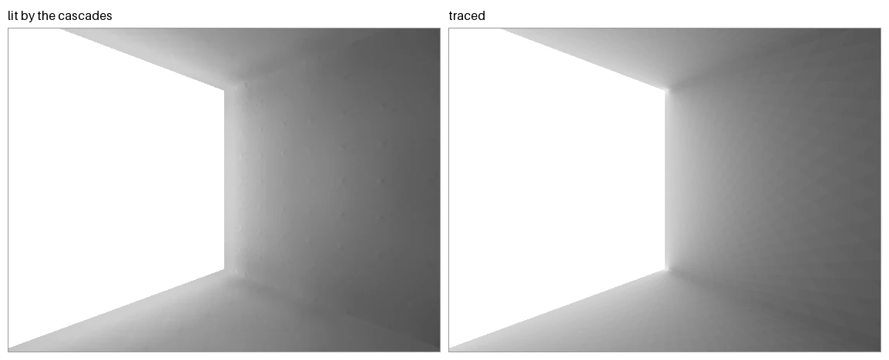
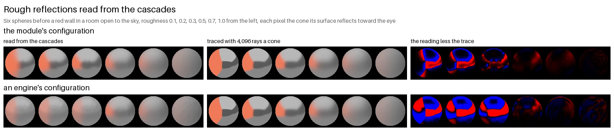
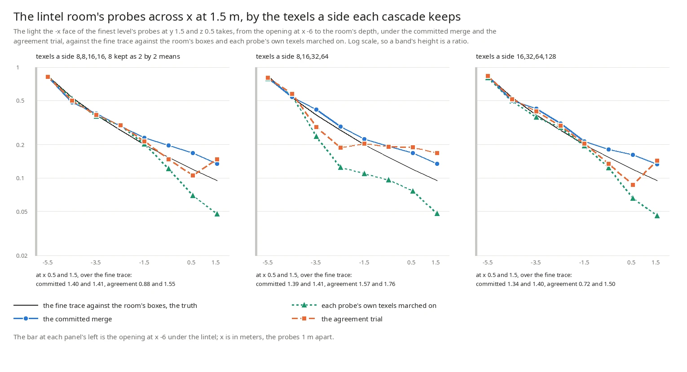
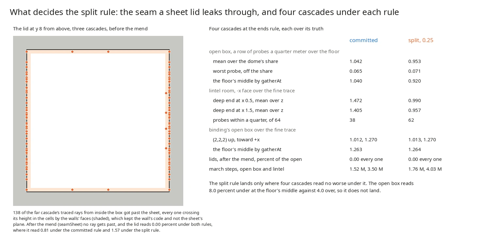
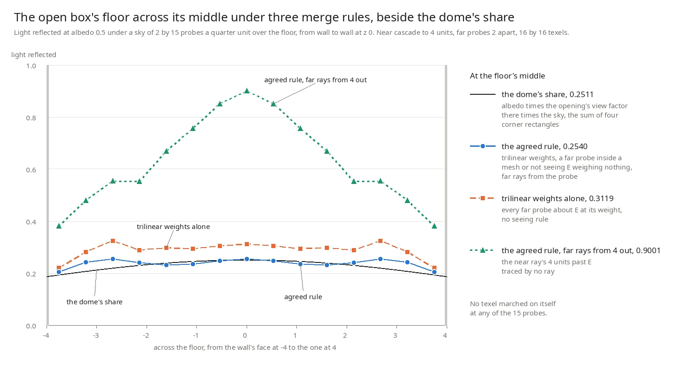
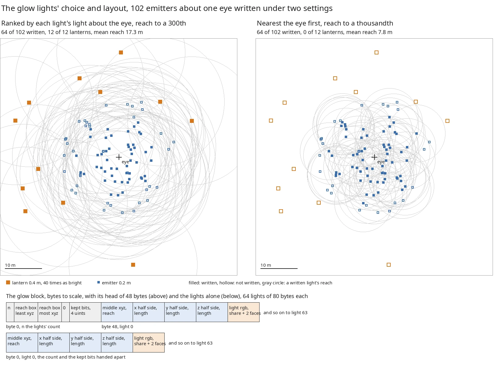
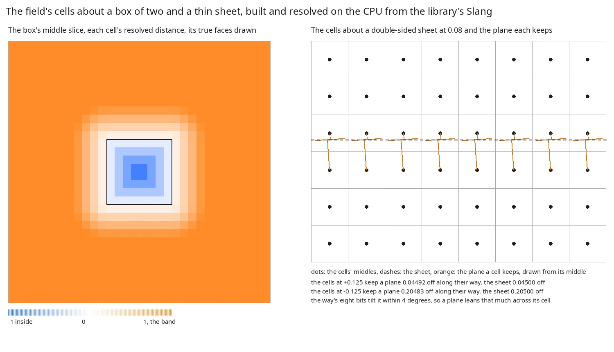
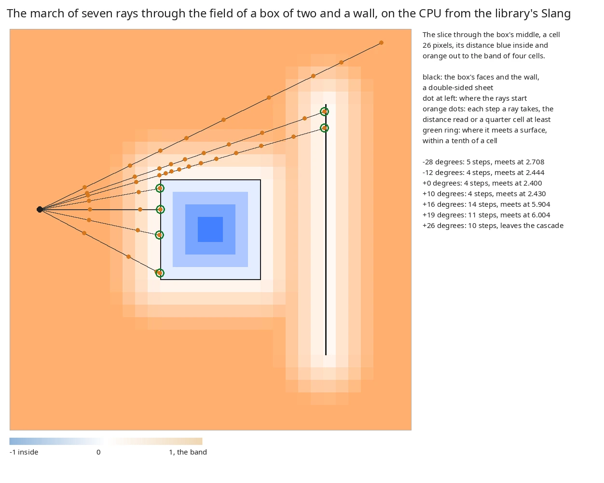

# RadianceCascades devlog

What landed in RadianceCascades, by day and newest first, with the pictures taken on the way, the
captures the repository keeps under `.github/assets` and the pictures made while an item was built,
kept under `.github/assets/readings` as WebP files named by their day, each on the day its name
says, and the notes written beside them as Markdown files named the same way. A line under Done
names the item of .github/REVIEW.md or .github/REVIEW-ARCHIVE.md and the commit that closed it.

## 2026-11-23

Commits that day

- `1e53334` Follows the court's surplus on the high wall to the level its points are gathered from,
  and lets the test binding gather a point within half a spacing past the finest level's probes to
  read what that would cost.
- `6aa63e9` Adds a merge that blends the far probes about the near probe's own place, and a court
  lit in a strip between arcades to the ladder, which keeps the merge at the ray's end as the
  default.

## 2026-11-22

A closed room whose left wall gives the light, its other walls, floor and ceiling lit through the
cascades on the CPU at 0.98 of the light traced to each point in all, beside that trace.

Six spheres of roughness 0.1, 0.2, 0.3, 0.5, 0.7 and 1.0 before a red wall in a room open to the
sky, each pixel the cone its surface reflects read from the cascades on the CPU, beside the same
lobe traced with 4,096 rays a cone and the reading less the trace, the module's reading within 0.04
of the trace from roughness 0.3 up and an engine's from 0.5 up.

Commits that day

- `151689d` A binding's log of one probe's trace and merge on its device is run again through the
  passes on the CPU, every call answered from the log.
- `11ece81` A rough surface's reflection is read from the merged cascades by a kernel of its own,
  measured on the CPU against the traced lobe by roughness, with a sheet of spheres beside their
  trace.
- `c395762` The ladder runs every merge to a steady state of the bounce, each hit lit from the
  probes of the round before, beside a traced loop over the same cells, and the CPU kernel's runs at
  once each enter a library of their own.
- `e310325` The merges gain a per-probe stage and a third rung, the merge by marched sight, and the
  ladder reads every merge at an engine's configuration beside the module's, a vestibule among its
  scenes.
- `af7d199` The passes take a merge by name through one shape, with the merge at the ray's end and a
  merge by reach sight as its first two rungs, the closed room, the thin wall and the lintel read
  under both, and a ladder that ranks every merge over seven scenes into the README and LADDER.md.
- `c0beccc` The README shows under its title a closed room lit through the cascades on the CPU
  beside its trace, and the norm asks each module's README to open with its own output.
- `1bad0f8` A grazing way handed off over a floor, which takes what the far probes over it see past
  a step it meets beyond its end, is a test of that over-read, since the march on that mended it on
  the CPU left one engine's door view as it was.
- `d33cfda` The held list's comment asks for its count set to 0 among the frame's commands before
  the listing and for the hold dispatched after it over every cell or sized on the GPU from the
  count, where a 0 from the host or a count read back leaves the count of the frame before.
- `84c4225` The march shades a surface once outside the loop its steps take, where inlined in that
  loop a binding's shading cost every step.
- `7a2f5de` A binding may list the cells whose light it holds and hold them a thread a listed cell,
  which took one binding's hold on Sponza from 2.72 to 1.60 ms.

## 2026-11-21

The light the face toward an opening under a lintel takes at the finest probes across the room at
1.5 m, for 8, 8, 16 and 16 texels a side kept as 2 by 2 means, 8, 16, 32 and 64, and 16, 32, 64 and
128, under the committed merge and the agreement trial, beside the fine trace against the room's
boxes and each probe's own texels marched on, the deep end at x 0.5 and 1.5 on that row staying 34
to 41 percent over the fine trace under the committed merge at every set, run on the CPU from the
library's Slang.

The sheet lid from above with the far rays that passed it in three cascades, every one through the
cells by the walls' faces that the field's seam closes, beside four cascades at the ends rule under
the committed and the split rule, the split rule reading the lintel room's deep end at 0.990 and
0.957 of the fine trace against 1.472 and 1.405 and the open box's floor 8.0 percent under its share
against 4.0 over, run on the CPU from the library's Slang.

Commits that day

- `2f0dc8e` The tests build their kernels for the CPU at -O2, since at slangc's own level Visual
  Studio's compiler built them unoptimized and the Windows job ran past its 30 minutes.
- `d446283` A closed room lit by one wall alone reads within three percent of the light traced
  against its faces, so the passes add no light to a closed room on one bounce.
- `0f0ff99` The held light reads a solid cell's side from the field's distance along the ray in two
  reads in place of the field's normal in six.
- `41f0e09` The held light keeps the far face of a solid thinner than a cell as a second side, and
  the read takes the side by the field's normal at the cell's middle, so a thin wall lit from one
  side reads dark from the other.
- `28eecdd` The lintel test traces its finest two cascades at twice the texels they are read at, and
  the README gives the face under the lintel by how many cascades are traced so as the stated limit
  of one ray a texel.
- `389f951` The held light keeps a light for each side of a sheet thinner than a cell and its own
  light apart from its probes', which a read weighs by the share the binding gives, and the GPU lock
  is taken through the Tools gate pinned at c389096.
- `c6bfb2a` A ray crossing a surface that lets light through takes the surface's light where it has
  stopped half the light it carried in, or at its last point within where it passes more, so a crown
  lit from before it reads its shaded inside for what it stops there.
- `88edf10` A closed room every face of which sends the same light reads that light at every point
  through four cascades, so the passes add no light to a closed room on one bounce.
- `23fec0e` A ray crossing a surface that lets light through passes each step's own cell's share
  over that step's depth, so a crown that passes more at its edge than at its core dims what lies
  past it as its depth does.
- `7e4a24c` The README says what a binding's own cheap hit at a merge keeps, the sun's reach read at
  the surface and the probes' light half a spacing off it, with the held light offered beside it and
  held whole each frame.
- `6e16181` The merge reads at a hit the light an engine holds for the field's cells through
  HeldHitLight, which holdCellLight holds a share of the cells a frame, in place of the engine's
  shading there, most of what a merge costs.
- `16af1c8` A probe inside a mesh keeps ReachInside in its reach map and the far probes about a
  hand-off are tested once, so the merge reads the field at no far probe's place.
- `c3b6671` The share of the sky a ray takes past the field is weighed by the sky beside its light,
  so a binding that lends a cascade no sky lends it no share.
- `8c103b1` The merge keeps the share of the sky in each texel beside its light in the same pass, so
  a binding that weighs its sky by that share merges once.
- `e660713` A surface point whose probes stand off it gathers its light along its own rays handed on
  through mergedLight, which gatherTraced gives beside gatherAt.
- `9613683` A binding passes the traced texels along a side of each read texel as
  TracedMeans.perRead, which reads a cascade at the mean of the traced texels each read texel holds.
- `a243f3d` A test holds the room under the lintel lit by the sky alone with every cascade traced at
  twice the texels a side it is read at, which the README states as the rule a binding traces by.
- `d373352` The merge's loop of marches is bounded at three with a return after it, since naga
  refuses WGSL whose function may end with no return.
- `3c843ea` The march calls an engine's hitLight at one place and the merge marches at one place, so
  a merge kernel holds the engine's shading once where it held nine copies.
- `9d19d77` A ray whose far probes disagree on where a surface lies along it marches across the far
  interval itself, so a room open under a lintel reads its deep end within a quarter of a fine trace
  where it read 1.4 times it.
- `109b457` A stamped cell carries the share of diffuse light its surface sends through, the winning
  box's held to one or the still cell's as it came, at a binding's request.
- `217b0ac` A cell in front of a solid's face takes the plane of a sheet resting on the solid that a
  neighbor keeps, so a march no longer slips past a lid laid on a box's walls, which let 0.81
  percent of the light through in three cascades.
- `c465a21` A test holds a room open under a lintel at the light its probes read today against a
  fine trace, and the README states that a hand-off near an opening's edge reads the room behind it
  about 1.4 times that trace.
- `e39dbb8` The gather says it gives a surface point the light of the probes about it at their own
  places and corrects nothing for a probe that stands off the surface, and the lintel room's probes
  are read against a fine trace at three counts of texels.

## 2026-11-20

Commits that day

- `a4748a7` The module takes Tools at its 3DEngine.Tools address and names its own repository
  3DEngine.RadianceCascades in the README's links and its submodule command, as every module's
  repository is named.
- `fa46096` The tests check that no kernel of the module keeps an array in a thread's own memory,
  and the README tells a binding to hold no table of cascades by value, since one macOS device reads
  such a copy wrong.
- `6b6f783` A ray takes the light of a surface it crosses weighed by what the surface keeps, so a
  lit canopy reads lit from below, and a binding may cap a march's steps, a capped ray handing on
  where it stopped, each held by a test run on the CPU.

## 2026-11-19

The light a floor in a box open to the sky reflects across its middle from wall to wall under three
rules of the merge, every far probe at its trilinear weight, the agreed rule weighing at nothing a
far probe inside a mesh or not seeing the near ray's end, and that rule with the far rays begun 4
units out, beside the dome's share, the agreed rule reading 0.2540 at the middle against the dome's
0.2511, run on the CPU from the library's Slang.

Commits that day

- `9f5b90b` A near ray past its end beside a surface marches on to it or to open space before it
  hands off, so a sunlit wall a little past a hand-off reads its light, held by tests run on the
  CPU.
- `fa4ccca` The probes' passes read a probe's place, a hit's light and the sky along a way through
  interfaces a binding implements, and a near texel takes the far texels it covers where the far
  cascade keeps more, each held by a test run on the CPU.
- `78ef6b6` The fetch of slangc reads an archive's sha256 with shasum, or with Python's hashlib
  where a system has none, in place of sha256sum, which not every system the scripts run on has.
- `6622616` The middle of three cascades ends at twice its spacing, which holds a floor in a box
  open to the sky within 5 percent of its share of the sky and a box lidded by a sheet dark, and the
  README states the ends' rule a binding follows with its limit.
- `02068b9` The library's Slang holds the probes' passes an engine's kernel calls once a thread, the
  trace, the reach, the merge from the coarsest cascade down and the gather, compiled for four
  targets and run on the CPU as the one-thread trace reads, with a test holding every Slang
  interface to a row in the README.
- `e211bdf` A picture of the light a floor in a box open to the sky reflects under three rules of
  the merge beside the dome's share, and the far probes' steps counted by the tests' kernel.
- `9ecdbbb` The library's Slang traces a probe's rays through the field and through surfaces that
  let light through, hands a near ray past its reach to the far probes about its end that see it or
  marches it on itself, and gathers a probe's light at a surface, held by four tests run on the CPU
  in a box open to the sky, a lidded one, one lidded by a sheet and two rooms parted by a wall that
  lets light through.

## 2026-11-18

Of 102 emitters about one eye, the 64 glow lights ranked by each one's light about the eye take all
12 bright lanterns 18 to 30 meters out, where nearest the eye first takes none of them and reaches
less far, above the glow block's bytes written with its head and as the lights alone.

The middle slice of the field's cells about a box of two as they resolve, below zero inside and out
to the band outside, beside the cells about a double-sided sheet at 0.08, the rows either side
keeping its plane 0.04492 and 0.20483 off along their way where it lies 0.045 and 0.205 off, built
and resolved on the CPU from the library's Slang.

Seven rays marched from one point through the field of a box of two and a double-sided wall across
the slice through the box's middle, each step a dot, the distance read or a quarter of a cell at
least, four meeting the box's face, two passing over it in short steps along its edge to meet the
wall, and one leaving the cascade, built and marched on the CPU from the library's Slang.

Commits that day

- `987e963` The library's Slang reads the field's distance at a point and marches a ray through it
  to the first surface, each step handed to a keeper of steps, held by tests run on the CPU about a
  box of two and a double-sided sheet, with a sheet of seven rays marched through a slice, and the
  README names every Slang interface an engine implements.
- `620bd21` The library's Slang stamps the boxes of the moving meshes into a cascade over what the
  still meshes made, the nearer surface painting each cell, its shape laid out by a writer of its
  own in the library, so a turned box stamps every cell near it at its distance and its color while
  a nearer still surface keeps its own, held by a test run on the CPU.
- `881fa74` The library's Slang splats a triangle into the cells its band covers through cells an
  engine keeps, each lane of a workgroup taking its share, and paints each cell by the triangle
  whose code it kept, so a box splatted a triangle at a time keeps at every cell the code the cells
  built one at a time keep and each face paints the cells beside it, held by tests run on the CPU.
- `17d068b` A cell outside both of two blocks that meet along an edge, between a cell inside each
  and across from one outside, is held inside by the field's pinch over the resolved cells about it,
  so a march through the edge meets the field, held by a test run on the CPU.
- `9e70dad` A face's way read back from its eight bits is held within 14.5 degrees of itself, its
  largest lean over 65,536 ways being 14.15, the paint's reach says the two bounds it stands
  between, a floor a fifth of a cell over another states the blend the read gives, and the cells'
  reading says its own way's lean.
- `6115a5e` A hit reads its color from the cells of the field about it that face its way and hold a
  surface through it, so a floor over another of another color a tenth of a unit below reads its
  own, held by tests run on the CPU, with a reading of the cells about a box and a thin sheet, and
  Tools pinned at its head with the cheatsheet and the devlog written again.
- `d573ea7` The library's Slang holds what a cell of the field keeps of the triangles near it and
  the distance the resolve makes of it, and tests run on the CPU build a box of two within a 1024th
  of a cell, part two meshes' coplanar faces by their instances and keep a thin sheet's plane on
  either side.
- `78fa4c5` The tests run a kernel of the library's Slang on the CPU, built by slangc through the
  system's C++ compiler and dispatched over its buffers, so the octahedral map's round trip at every
  texel and the texels' marks are read as they compute, skipped with the reason where no compiler is
  found.
- `866bba7` The cheatsheet is one word wherever the module writes it, and a seventh fact from Tools
  holds the README to its link row above its title.
- `38470fd` The module names no engine in any text it keeps, the plan's and the glow lights' forms
  are settings each at a default with what it does and trades, the cascade's lead one of them, the
  read of two engines' copies leaves the repository, and the tests take the shared check of every
  tracked text.
- `ff7571b` The module holds the glow lights' choice and layout, which emitters are carried and cut
  into parts, the 64 that send the most about the eye written into a block of its own against the
  frame's origin, with three ways the engines part behind a record of forms each engine names, ten
  tests on the CPU, and a sheet of the lights each ranking writes about one eye and the block's
  bytes.
- `f44ae1a` The README says how an engine binds the module, what the plan asks and hands back, the
  conventions it stands on and which forms an engine new to it names, its smallest binding run by a
  host in the tests with no engine and held line for line to the README, and every form is named
  where a plan is made.
- `35f76c3` The tests compile the library's Slang to HLSL and to Metal beside SPIR-V and WGSL, each
  kernel's entry named since Metal reserves main, and the README says how an engine in any language
  compiles the kernels with slangc alone.
- `448f28b` The plan holds four ways the two engines' plans part behind a record of forms each
  engine sets, a cascade lying ahead of the eye, meshes stamped until they are built, every build of
  a whole cascade and a mesh painted again waiting for its new paint to settle, with a reflectance
  and a share sent through on each draw and stamp, 10 more tests held with every form set, the
  probes' cascade tested on its own and the forms tabled with what will choose between them.
- `03da2c4` The plan compares an engine's tag with the rest of a draw, so a draw whose tag changes
  is its mesh painted again, the budgets and the pool are worked out without overflow at the largest
  counts, and a mesh's triangles are refused colors of another count than its vertices, each held by
  a test that failed before the mend.
- `643e32c` The library builds as the assembly 3DEngine.RadianceCascades under the package id of the
  same name and its tests as 3DEngine.RadianceCascades.Tests, the namespace staying
  RadianceCascades.
- `6d60f08` The module holds the scene field's plan, where each cascade lies about the eye, which
  cascades, regions and shifts are built each frame under the budgets and which meshes are stamped
  as boxes, generic over what an engine knows a mesh by, with the layout of the triangles the builds
  read, their open edges, the pool's size and the cut of a rigid mesh into parts, held by 32 tests
  on the CPU.
- `ebd3470` The fetch of slangc refuses an archive whose sha256 is not the one its release lists,
  and writes its stamp only once the compiler runs, so a compiler that does not run is fetched
  again.
- `8d11f8c` The module holds its first Slang, a probe's directions on an octahedron with the rays
  and marks of its texels as both engines lay them out, compiled by the tests to SPIR-V and to WGSL
  with the slangc both engines pin, which the workflow fetches on the three systems, and a test
  holds every comment line to 100 columns.

## 2026-11-17

Commits that day

- `6b7bcd8` The ignore file's note on the pictures folder names no one, and the guides spell
  canceled.

## 2026-11-14

Commits that day

- `ad7841e` The kernels' document names no item of the review where it says what the move needs, the
  move of the code into the module in its opening and the move in its section of tests.
- `21761ff` The interface's opening says the choice between the two forms is made when the kernels
  move, naming no session and no item.
- `040353c` The kernels' document writes out the ten things an engine gives a kernel as the
  declarations the module would hold, each field and function with its name in both engines or the
  engine that lacks it, and what each engine changes in its own files to give them.
- `13d21db` The kernels' document gains what holds each kernel today, each engine's tests for every
  pair with the device each runs on and the gaps between them, the rooms both engines draw alike,
  and the order the kernels could move in.
- `7806020` A document reads the radiance cascades of both engines kernel by kernel in the order a
  frame runs them, with where each pair differs and which form is the later, the three findings
  placed at their kernels and the interface the module would ask of an engine.

## 2026-10-31

Done that day

- Item 1 at `8811a8e`. The documents, one commit.
- Item 2 at `8cc387d`. The skeleton, one commit after item 1.

Commits that day

- `8cc387d` The module gains its solution, an empty library whose public members need summaries, a
  test that it loads, the version at 0.1 and a build workflow on Linux, Windows and macOS.
- `8811a8e` The module gains its documents, AGENTS.md, the README, STYLE.md, COMMITS.md and the code
  of conduct as the engines keep them, with git's ignore and attribute files.
