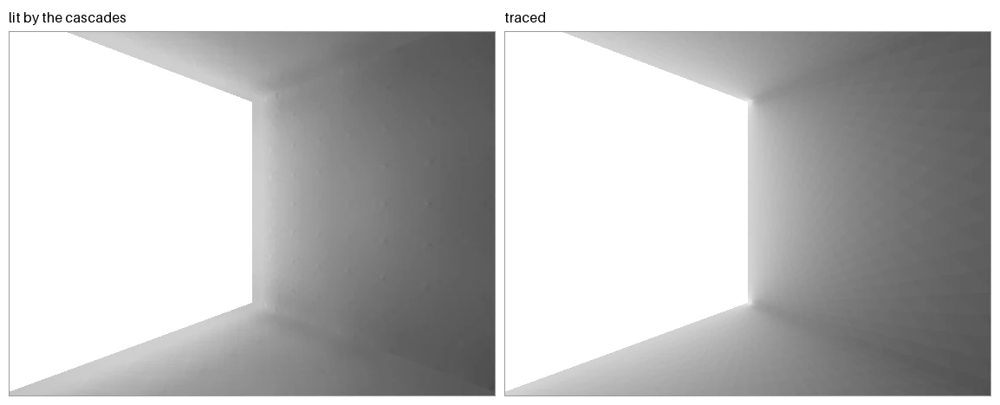

[Devlog](https://github.com/EggyStudio/3DEngine.RadianceCascades/blob/main/DEVLOG.md) [Cheatsheet](https://github.com/EggyStudio/3DEngine.RadianceCascades/blob/main/CHEATSHEET.md)

# RadianceCascades



A closed room whose left wall gives the light, its other walls, floor and ceiling lit through the cascades on the CPU, beside the light traced to each point.

RadianceCascades is a library for any engine that binds it, taken as a git submodule, for the CPU
side of radiance cascades, their layout, the placement of their probes, the build of the scene field
and the rules of the merge, and their Slang shaders. It references no engine, window or graphics
API, and an engine gives it what it cannot work out where it binds the module.

## Taking it into an engine

An engine adds the repository as a git submodule under `modules/` and references its project, here
from a project one folder below the engine's root.

```bash
git submodule add https://github.com/EggyStudio/3DEngine.RadianceCascades.git modules/RadianceCascades
```

```xml
<ProjectReference Include="..\modules\RadianceCascades\RadianceCascades\RadianceCascades.csproj" />
```

The library's Slang lies under `RadianceCascades/Shaders`, a module a file, which an engine's
kernels import with that folder among the folders its slangc searches.

A clone of the engine fetches the module with `git clone --recurse-submodules`, or with
`git submodule update --init` in a clone made without it, and a workflow checks it out with
`submodules: true` on `actions/checkout`. A change the engine uses is committed and pushed here
before the engine's commit that moves its pointer, so the engine's history never names a commit
this repository does not have.

## Building and testing

The tests take the checks every module keeps from the Tools module, a git submodule under
`modules/Tools`, so a clone fetches it with `git clone --recurse-submodules`, or with
`git submodule update --init` in a clone made without it. An engine that takes the module builds
its library alone, which takes nothing of Tools', and clones with no recursion into it.

With the .NET 10 SDK, and slangc for the tests that compile the library's Slang to SPIR-V and to
WGSL, which `build/fetch-slang.sh` downloads into `build/tools` at the version the script pins:

```bash
build/fetch-slang.sh
dotnet build RadianceCascades.slnx
dotnet test RadianceCascades.Tests
```

Without slangc those tests are reported as skipped, with their reason. The tests that run a kernel
on the CPU take the system's C++ compiler as well, which slangc calls to build the kernel, and are
skipped with their reason where it finds none.

A binding whose light on its device parts from the CPU's can log one probe's trace and merge, each
call the passes make through the shapes it implements with its arguments and result, and each
texel's ray and kept light. `ParityReplayTests` runs the passes again on the CPU with every call
answered from that log, so the two part only where the passes' calls or their kept light part, and
a difference that remains lies in what the binding answers:

```bash
RC_PARITY=<folder of frames> dotnet test RadianceCascades.Tests --filter FullyQualifiedName~ParityReplay
```

Each frame is a folder of `header.json` (the cascades, the field's layout and each texel's place in
the log), `texels.json` (each texel's rays and kept light) and `calls.bin` (16 uints a call, the
kind, the arguments and the result).

## Binding it in your engine

An engine binds the module by making a `SceneFieldPlan<TMesh, TTag>` and handing it each frame the
eye and the meshes it drew. The plan says which cascades of the scene's distance field are built and
from which still meshes, and which moving meshes are stamped as boxes. The module declares no
interface for an engine to implement, and asks what it cannot work out through the plan's type
parameters and the functions its constructor takes.

| Asked | What the engine gives |
|---|---|
| `TMesh` | What it knows a mesh's vertices by, compared through `EqualityComparer<TMesh>.Default`, by reference for an array or a class with no equality of its own, and boxed on each comparison where it is a struct that does not implement `IEquatable<TMesh>` |
| `TTag` | Its own of each draw, an `IEquatable<TTag>` carried to the builds and compared with the rest of the draw, so a draw whose tag changes is its mesh painted again |
| `bounds` | The box around a mesh's vertices in its own space, a `FieldBox` |
| `triangles` | How many triangles a mesh has |
| `options` | Where it gives them, the plan's settings, a `FieldPlanOptions`, each at a default it may leave, as the table below says |
| `parts`, `tint`, `carried` | Where it gives them, the parts a rigid mesh is stamped as, each a `FieldPart`, which `FieldTriangles.Cut` cuts, the color a mesh's boxes are multiplied by, and whether it carries an emissive mesh as a glow light |
| `GlowOptions` | For `GlowLights.Write`, the box around a mesh's vertices, its surface over its box's, which `GlowLights.ShareOf` works out from its corners or its area, and where it gives them, the glow lights' settings, a `GlowOptions` |
| `GlowPart` | Where it gives them, the parts an emissive mesh is carried as, each a `GlowPart`, which `GlowLights.PartsOf` cuts from its corners, and whose boxes `GlowLights.Carries` reads for the plan's `carried` |
| `FrameOrigin` | Where it takes its places against an origin of its own, the frame's origin in doubles, which the glow lights are gathered against and `GlowLights.Place` places them against, `FrameOrigin.Zero` where it takes none |

| Handed back | What it holds |
|---|---|
| `SceneFieldPlan<TMesh, TTag>.Builds` | Each cascade built this frame, or the part of its build splatted, with its corner, its cells' width and the still meshes it splats, and the `FieldCells` it builds where it builds a region or a shift's slab |
| `SceneFieldPlan<TMesh, TTag>.Shapes` | The moving meshes stamped as boxes, each a `FieldShape`, with the bricks they come within in `Bricks`, `BrickRanges` and `BrickShapes` |
| `FieldTriangles` | The layout of the triangles a build's splat reads, 48 bytes a triangle, written by `FieldTriangles.Write`, a corner's color made by `FieldTriangles.Srgb`, and the size of the buffer that holds them by `FieldTriangles.PoolCapacity` |
| `GlowLights` | The block the glow kernel reads, written by `GlowLights.Write` into the span it is given, a head of `GlowLights.Head` bytes ahead of `GlowLights.Most` lights of `GlowLights.Bytes` each, or the lights alone, and how many carried emitters there were |
| `GlowLight` | A light `GlowLights.Gather` finds, its box's middle and half sides, its light, its share and the faces it emits from |
| `GlowPlaces` | The place each light is written in, kept from frame to frame by the one the engine hands `GlowLights.Write`, with the count of places taken and the bits of those whose light is the frame before's |

The library's Slang, under `RadianceCascades/Shaders`, asks an engine for its own images and
buffers through interfaces its kernels implement, each a struct of the engine's own handed to the
library's functions, and the engine keeps its bindings, its threads and its atomics.

| Slang interface | What the engine's struct reads or writes | Read or written by |
|---|---|---|
| `ISplatCells` | Keeps a cell's least code and the least code of a face it lies straight behind, an atomic minimum on a GPU | `splatCodes` |
| `IPaintCells` | Reads the code a cell kept and paints it its nearest surface's color, emission and gloss | `splatPaint` |
| `IResolvedCells` | Reads a cascade's resolved distances about a cell | `pinched` |
| `IStampShapes` | Reads the shapes of a brick's run, each as `FieldShape.WriteStamp` writes it | `stampCell` |
| `IFieldCells` | Reads a cascade's cells' paint, faces and distances | `paintFacing`, `paintAt` |
| `IFieldVolume` | Reads the finest cascade holding a point, a cascade's corner and cell, its field between cells and a cell as it is | `seamSheet`, `fieldDistanceIn`, `fieldDistanceSheetIn`, `fieldNormalIn`, `traceField`, `traceFieldSheets`, `reachAlong`, `reachTexel` |
| `IMarchSteps` | Takes each step a march makes, which `NoSteps` passes over | `traceField`, `traceFieldSheets`, `traceProbeRay`, `marchToOpenSpace`, `reachAlong`, `opaqueAlong`, `seesAcross`, `mergedLight`, `mergeTexel`, `stageProbe`, `gatherTraced` |
| `IProbeField` | Reads, beyond `IFieldVolume`, the light a surface a ray meets or crosses sends back along the ray as the engine shades it, from the hit's place, the ray's way, the cascade and the cell, and the share of light that passes a unit of a surface's depth | `traceProbeRay`, `marchToOpenSpace`, `opaqueAlong`, `seesAcross`, `mergedLight`, `traceTexel`, `mergeTexel`, `stageProbe`, `gatherAt`, `gatherTraced` |
| `IFarProbes` | Reads a far probe's light at a texel and how far its ray toward each way of its reach map went, the merged light and reach maps of the level above a merge's or of the finest level a gather's, which `TracedMeans` reads at fewer texels than traced | `mergedLight`, `farTexelsLight`, `farProbeSees`, `mergeTexel`, `gatherAt`, `gatherTraced` |
| `IFarSkyProbes` | Reads, beyond `IFarProbes`, the share of the sky in a far probe's texel's light, what it would be under a sky of 1 with every surface unlit, which `TracedSkyMeans` reads at fewer texels than traced | `mergedLight`, `farTexelsLight`, `mergeTexel`, `gatherAt`, `gatherTraced` |
| `IProbePlaces` | Reads where a cascade's probe stands, by the engine's own rule where it moves a probe off a surface, which `GridPlaces` gives as the grid's place | `traceTexel`, `reachTexel`, `mergedLight`, `mergeTexel`, `gatherAt`, `gatherTraced` |
| `ISky` | Reads the sky's light along a way, for a ray that leaves the field, which `UniformSky` gives as one light | `lastCascadeLight`, `mergedLight`, `settleTexel`, `mergeTexel`, `gatherTraced` |
| `ISkyShare` | Reads, beyond `ISky`, the share of a sky of 1 a ray leaving the field along a way takes, 1 for a sky lent whole, which `WholeShare` and `UniformSky` give | `lastCascadeSkyShare`, `mergedLight`, `settleTexel`, `mergeTexel`, `gatherTraced` |
| `IProbeLight` | Reads a probe's merged light at each of its texels | `lightTaken` |
| `IProbeRays` | Keeps the ray each texel of a cascade traced, how it ended, where, the share of light it carries and the light it met, and reads it back | `traceTexel`, `settleTexel`, `mergeTexel` |
| `IReachTexels` | Keeps how far each ray of a cascade's reach maps went, `ReachOpen` where it met no surface and `ReachInside` along every way of a probe inside a mesh, which `IFarProbes` reads back | `reachTexel` |
| `IMergedLight` | Keeps each texel's light merged from every distance past its probe, which `IFarProbes` reads back for the level below and the gather | `settleTexel`, `mergeTexel` |
| `IMergedSkyLight` | Keeps, beyond `IMergedLight`, the share of the sky in each texel's merged light, which `IFarSkyProbes` reads back | `settleTexel`, `mergeTexel` |
| `IMerge` | Brings a texel the light from past its ray's end out of the coarser cascade's probes, a merge of the ladder's under its own name, which `MergeAtRayEnd`, `MergeByReachSight`, `MergeByMarchedSight` and `MergeAboutProbe` give, and says whether it reads the per-probe stage | `mergeTexel`, `gatherTraced` |
| `IProbeStage` | Works out one value for a probe of a cascade from its place and the far cascade's probes, once a probe for every texel of it to read, which `FarSightLines` gives as the lines of sight to the eight far probes about it | `stageProbe` |
| `IStageKeep` | Keeps each probe's value of the per-probe stage, one uint a probe | `stageProbe` |
| `IStageValues` | Reads a probe's value of the per-probe stage back for a merge that reads it, which `NoStageValues` gives as none | `mergeTexel` |
| `ISurfacePoints` | Reads a surface point's place and normal and keeps the light it takes | `gatherAt`, `gatherTraced` |
| `ISurfaceSkyPoints` | Keeps, beyond `ISurfacePoints`, the share of the sky in the light a surface point takes | `gatherAt`, `gatherTraced` |
| `IHeldLight` | Keeps and reads the light each side of the surface nearest each of the field's cells within a cell and a tenth of a surface sends, its own apart from its probes' light, one side for a solid's cell and two for a sheet's (`heldSide`), and gives the share of the probes' light a hit takes, which the merge reads at a hit through `HeldHitLight` in place of the engine's shading | `holdCellLight`, `holdListedCell`, `HeldHitLight` |
| `IHeldShading` | Shades a held cell's surface, its own light and its probes' apart, which `WholeShading` gives from `IProbeField.hitLight` as its own alone | `holdCellLight`, `holdListedCell` |
| `IHeldList` | Keeps the list of the field's cells whose light is held, a cell added as `listHeldCell` finds it, the count of cells listed and each listed cell, which `holdListedCell` holds a thread a cell | `listHeldCell`, `holdListedCell` |
| `IConeLevels` | Reads the levels a cone is read from, finest first, each level's cascade at the texels it keeps, a probe's merged light at a texel, its reach toward a way and its place | `coneLevel`, `ConeAtProbes` |
| `IConePoints` | Reads a point's place, normal, way toward the eye, roughness and the finest level its gather reads, and keeps the light its cone reflects | `readCone` |
| `IConeRead` | Brings the mean light of the cone a rough surface reflects toward the eye from the levels about it, one read behind one name, which `ConeAtProbes` is the first of | `readCone` |

The engine's struct is handed to the library's functions by value, so an array it holds is copied
into each thread's own memory where it is read, which one macOS device reads wrong where every other
reads right. `IFieldVolume` asks for a cascade's corner and cell by its index and for the cells
along a side, never for a table of cascades, and the engine's struct reads them by index from a
buffer of its own or holds the one cascade it reads, never a table by value. An interface names a
struct's functions and never its fields, so no shape of it keeps an array out, and the tests hold
the module's own kernels to it instead: each is compiled to SPIR-V and none keeps an array in a
thread's own memory, a check an engine may run on its own kernels by the same reading.

The conventions the module stands on:

- Places, cells and reaches are in the engine's world unit, which the module's defaults and
  numbers take as meters, a first cell of 0.25 a quarter meter.
- A `Matrix4x4` of System.Numerics takes a point from a mesh's own space to the world as
  `Vector3.Transform` does, a row vector times the matrix, with the translation in `M41` to `M43`.
- The plan reads no up axis and no handedness, and the octahedron of a probe's directions folds
  along z as a mapping alone.
- `Color` and `Emission` are linear, and a corner's color is three sRGB bytes, red lowest.
- Emission is in the engine's own unit of light, which the plan carries and neither scales nor
  reads.
- A cell of an engine's field carries its nearest surface's share of light through, the share
  that passes a unit of its depth, as a value of its own, which `IProbeField.throughAt` reads, and
  not in the paint's alpha, which `lightThroughPaint` makes of it for the blend of colors alone.
- A ray that crosses a surface letting light through takes the surface's own light
  (`IProbeField.hitLight`) where the crossing has stopped half the light carried into it, or at its
  last point within where it passes more, since the light of the place a crown is met at, taken for
  all the crossing stops, reads its sunlit front for the shaded inside behind it: a crown lit from
  before it reads a probe there 0.96 of its trace, where taken where the ray met it read 1.58 times
  it, in the same steps. The light is weighed by what the surface keeps, one less what it passes,
  and by the share of light carried to it, and the ray carries on what the surface passes. A closed
  surface passes over the depth crossed, from where the march meets it to where it comes out, the
  share of the cell each step within began in to the power of that step's depth, so a crown whose
  leaves pass more at its edge than at its core dims what lies past it as its depth does: one 6
  units deep passing 0.9 a unit within a unit of its faces and 0.3 within, held as one region half a
  cell inside throughout, reads the sky a probe 2 units before it takes through it 0.99 of its
  trace, where with the share it was met at taken for its whole depth it read 1.23 times it, and a
  double- sided sheet thinner than a cell, which has no depth to cross, passes its share once, as a
  unit of depth would.
- A cascade's `stepCap` in its `ProbeCascade` is the most steps a march of its rays takes, 0 for no
  count. A ray that stops at it ends as `RayCapped` and is handed to the cascade above from where it
  stopped, as from its end, and at the coarsest cascade it takes no light past its stop. The
  marches past a ray's end, to open space and on itself, take the cascade above's cap.
- A cascade above keeps as many texels along each side of a probe's octahedron as the cascade below
  or a whole multiple of them, and each texel below takes the texels above that its solid angle
  covers, each weighed by its own (`farTexelsLight`). At any other count a texel below takes the
  one texel above its middle way falls in.
- A cascade's end, set in its `ProbeCascade`, lies no farther than twice its own spacing and past
  its spacing times the root of three, the coarsest's alone past the field's edge. A finer cascade's
  end is where its rays are handed to the cascade above, whose probes about that point stand up to a
  spacing of theirs off the ray and meet an edge where their own rays do, so a hand-off near an edge
  smears the edge over the ways about it. A ray that reaches its end where the field reads a surface
  nearer than a far spacing, or than the field's band where that is less, marches on itself to open
  space and is handed on there (`marchToOpenSpace`), which holds a sunlit wall 0.4 units past a
  probe's reach at its share of the light, where handed on at its end it read 37 percent under. The
  band is 4 cells, a unit at a first cell of a quarter, so an edge farther than that past a hand-off
  is still smeared. The lower bound keeps a cascade's reach map covering the cell about any point
  handed to it. Every cascade's rays begin at its probe. A binding may begin the rays of each
  cascade above the finest at the finer one's end, which took one engine's trace from 4.02 to 3.27
  ms and from 5.50 to 5.14 in two scenes, and leaves the near ray's next interval past its end
  untraced by the far probes about it, so that a floor in a box open to the sky took the sky's light
  along every way whose ray meets a wall there, 3.6 times what it should.
- Where the far probes about a hand-off that count disagree on where a surface lies along the ray,
  some meeting one within their reach and some none, or all meeting one at points of the ray
  farther apart than a quarter of the farther (`HitSpread`) and two cells, the ray takes none of
  them and marches on itself across the far interval, to the far cascade's own end past the
  hand-off, and is handed on where that march ends, or takes the surface it meets or the sky where
  it leaves (`mergedLight`). Far probes standing a spacing off a ray that ends short of an
  opening's edge see past the edge where the ray meets it, and the march meets the edge where they
  would smear it. In a room open to the sky under a lintel, at 8, 8, 16 and 16 texels a side, the
  probes 6.5 and 7.5 units in from the opening read their faces toward it 0.99 and 0.96 times the
  light traced finely against its surfaces on the mean, and 62 of the finest cascade's 64 probes
  read within a quarter of it, where with the far probes taken as they stand they read 1.47 and
  1.41 and 38 of 64. In a box open to the sky, four cascades 1, 2, 4 and 8 apart at the ends rule
  read the floor's middle by `gatherAt` 8 percent under its share of the sky, where with the far
  probes taken it read 4 percent over, and a middle cascade a unit apart reads the floor 0.3
  percent under reaching 2 and 4 alike, where it read 1.5 percent over and 12.4 percent under. A
  box open to the sky with a floor of albedo 1 under probes 2, 4, 8 and 16 apart, as an engine's
  binding lays them, reads the same with the rule and without it, within 0.0002. The merge takes
  about 1.15 times the steps under the lintel and in the four cascades' box. The rules lessen the
  smear and do not end it, in any chain, and the tests hold the boxes, the lids, the wall and the
  room under the lintel alone.
- A cascade is traced at `TracedMeans.perRead` texels along a side of each texel the cascade below
  and the gather read it at, 1 or 2 as a binding chooses for each cascade, and each texel they read
  is the mean of the traced texels it holds weighed by their solid angle, so at 2 its light is that
  of four ways spread over its solid angle. A binding wraps its own reads of the traced texels in
  `TracedMeans` and passes `readCascade`'s cascade beside it to `mergeTexel` and `gatherAt`. A
  texel's middle way alone reads a thin strip of sky the texel holds part of as all of it or none,
  and the merge's march past a ray's end runs along it too. In the room under the lintel lit by the
  sky alone, each cascade read at 16 texels a side and the finest gathered at 8, the face toward the
  opening of the probe 6.5 units in reads the light traced there as the table under this list gives,
  the stated limit of one ray a texel: the march past a finer cascade's ray's end meets the ground
  outside along the texel's middle way short of the ground's end, where a third of its solid angle
  sees the sky past it. A texel whose ray ends unlike a neighbor's, traced from its quarters, reads
  0.69 at 1.8 times the steps, since the finer cascades' rays end in open space and agree with their
  neighbors, and its quarters handed on with no march read 1.07 and lose what the march mends, the
  four cascades' open box reading up to 1.25 times its share. Each traced texel weighs by its solid
  angle, as `farTexelsLight` weighs the far texels a near texel covers: an even mean read the face
  0.94 with every cascade traced at 2, counting the texels by the octahedron's corner toward the
  opening, which see the sky and span the least solid angle, as whole ones.
- A probe whose place lies inside a mesh keeps `ReachInside` along every way of its reach map, which
  `reachTexel` writes, and the merge and the gather pass a far probe over by its reach alone
  (`farProbeSees`), reading the field at no far probe's place. A binding that writes its own reach
  maps keeps it the same way. The merge tests the far probes about a hand-off once, for the split
  and the light alike. Read for every ray at each of the eight far probes' places, twice where the
  split was tested, the field's distance came to two in three of the merge's reads of the field, and
  the reach toward the hand-off a third of its reads of the reach maps; with neither, every reading
  of the tests stands as it was.
- `mergedLight` takes the far cascade as it stands, its own end the one its probes' rays and reach
  maps run to, and after it `marchEnd`, the coarsest cascade's end, to which a march past every far
  interval runs. A binding that calls it itself, and not through `mergeTexel`, which takes both,
  passes the two apart, since a far cascade whose end is set to the coarsest's marches across to
  the coarsest's end wherever its probes disagree. `reachAlong` gives `ReachOpen`, 1e30, where its
  ray meets no surface before its end or leaves the field, and the merge reads a reach at or past
  it as no surface met. An engine's reach image keeps it so it reads back at or past `ReachOpen`. A
  32-bit float keeps it and a 16-bit float holds it as infinity, which reads past it, and an image
  that scales reaches into a fixed range reads its top back as `ReachOpen`, since a reach clamped
  short of it reads as a surface met where none is.
- The march calls `IProbeField.hitLight` at one place, and `mergedLight` marches at one place for
  every leg past a ray's end, so a trace kernel holds a binding's shading once where it held three
  copies and a merge kernel once where it held nine. A driver inlines the shading at every call, and
  one engine's, which shades with its sun's and lamps' shadows, took 46 s to compile in a trace and
  2.6 minutes and 3.75 GB in a merge. A binding shades a surface in hitLight itself, with nothing to
  gather after the march. The one call lies outside the loop the march's steps take, in a loop about
  it that shades once and goes on, since a shading inlined in the steps' loop is paid for at every
  step: one engine's trace took 4.02 and 5.50 ms in two scenes so, and 1.75 and 2.02 with its
  shading after the steps' loop.
- The engine's shading at the surfaces a merge's marches meet is most of what the merge costs: of a
  merge of three cascades that took 4.9 ms on Sponza and 9.2 on the Bistro on one engine, its
  marches and reads took 0.54 and 0.57. A merge that takes nothing at a hit reads the room's deep
  end under the lintel 0.51 of the light traced there against 0.82, 4 of its 64 probes within a
  quarter against 62, and a sunlit wall a little past the near rays' reach 44 percent under, and one
  that takes in its place the far probes' light about the hit reads an open box's floor 1.49 times
  its share, so the merge shades its hits. `mergeTexel` takes a field of its own, and a binding
  passes it a cheaper hit than its trace's, which keeps two things. It reads the sun's reach at the
  surface itself, its sun map at the hit or a march toward the sun where the map does not reach,
  since a sun's reach read at the probes about the hit read a sunlit passage 0.37 of its light and a
  shaded floor beside a sun patch 2.49 times its trace. And it reads the probes' light half a
  spacing off the surface toward the ray, so that a probe behind the surface counts for nothing. One
  engine's cheap hit, its probes' kept light in one filtered read and its sun map at the hit with no
  lamps, took the whole merge of five cascades 1.03 ms on Sponza and 1.07 on the Bistro. Beside it
  the module offers a held light, which a binding takes where its lamps fail under the cheap hit: an
  engine that holds the light of the field's cells (`IHeldLight`) passes the merge `HeldHitLight`,
  which reads at a hit the light held for the cell it lies in, and dispatches `holdCellLight` over
  every cell each frame, each within a cell and a tenth of a surface shaded once where a march
  toward it along its normal stops. Or it lists the cells to hold first (`listHeldCell`, into an
  `IHeldList` of its own) and dispatches `holdListedCell`, a thread a listed cell, since a thread a
  cell over the whole field leaves most threads with no cell to shade and a workgroup whose one
  thread shades takes as long as one whose every thread does: one engine's hold took 2.72 ms on
  Sponza and 2.95 on the Bistro over every cell and 1.60 and 1.71 listed first, the listing 0.048
  and 0.064 more, and on the CPU the listed cells hold the same light, the same 50,177 cells of
  524,288. The merge so took 0.55 and 0.56 ms, and shading every cell within a cell of a surface
  once 1.91 and 3.07 more, 170,000 and 125,000 cells of 1.3 million, and the sunlit wall reads 0.6
  percent under the light it takes shading its hits and the sunlit sheets 0.04 percent over. A share
  of the cells a frame, `share` above 1, lags a change in the scene by as many frames, so a binding
  whose lighting is to show a change in the next frame holds the cells whole. A cell holds a light a
  side and the read takes the side the ray meets, by the cell's normal, a kept sheet's plane's or
  the field's at its middle, the far side a sheet's or the far face of a solid thinner than a cell
  found within 1.2 cells of the middle, and side 0's light again where none lies there, since one
  light a cell read a sheet lit on one side by its lit side from the other, the foot of a thin
  room's wall lit by a lamp outside 2.11 times its light on one engine, and on the CPU a probe under
  a sheet lit from above alone 0.27710 where it takes nothing, and one before a solid wall 0.1 thick
  lit from beyond it 0.27366; the holding pass shades twice a sheet's cells, 6,272 of a lone sheet's
  9,860 held cells and 2,144 of a box's 27,856 under a sheet for a lid, and the cells about a thin
  solid, 2,944 about that wall, and reads the field up to 8 times more for each other held cell. A
  cell holds its own light apart from the light of the engine's probes it reflects (`IHeldShading`),
  and the read weighs the probes' light by the share the engine's own hit gives it
  (`IHeldLight.probeShare`), since a held light taking it whole kept a panel's light that went out
  at 5.67 times its light two frames on where the engine's gather lets it go within two, and on the
  CPU read a sunlit wall whose hits take a quarter of their probes' light 29 percent over and with
  the share 0.6 percent under. A held light gives up the gloss toward the eye a hit's own shading
  weighs.
- A field's build runs `seamSheet` over its resolved cells, as it runs the pinch, and keeps the
  plane it gives in the cell, whose distance stays its own. A sheet thinner than a cell resting on a
  solid's top passes over the cells in front of the solid's face, which keep the solid's code, and
  without the plane a neighboring cell lends them a march slips between their middles past the
  sheet: a lid laid on a box's walls let 0.81 percent of an open box's light through in three
  cascades and 0.70 in two, and none with it.
- The merge keeps beside each texel's light the share of the sky in it, what the light would be
  under a sky of 1 along every way with every surface unlit, so a binding that weighs a
  reflection of its sky by the share merges once where a second merge of every texel under that
  sky gave it. A ray that takes the sky brings the share it carries there
  (`lastCascadeSkyShare`), and at a hand-off the far probes' shares (`IFarSkyProbes`) weighed as
  their light is, times the share carried. Each pass and `mergedLight` has a form over
  `IFarSkyProbes` and `IMergedSkyLight` or `ISurfaceSkyPoints` that keeps the share, and its form
  over `IFarProbes` reads the probes through `NoSkyShares`, whose shares are none, so the march
  holds a binding's shading once in either. A ray that leaves the field takes the share the sky
  lends along its way (`ISkyShare.shareAlong`), so a binding that lends a cascade no sky, as one
  does before its field holds every mesh in reach, gives its share 0 there beside its light, and
  the share form of each pass takes an `ISkyShare`. Its form over `ISky` lends the sky whole
  through `WholeShare`.
- A surface point takes from `gatherAt` the light the finest cascade's probes about it bring at
  their own places, weighed as the merge weighs the probes about a ray's end, and nothing corrects
  it for a probe that stands off the surface. A probe a spacing above a floor sees what that height
  sees, more of the sky in a box open above it than the floor sees. A surface that wants its own
  light takes it from `gatherTraced`, which sends a ray from the point along each way of the
  cascade's octahedron that faces its normal, a cell off the surface, and hands each on through the
  merge it takes (`IMerge`, `MergeAtRayEnd` where it takes none) to the cascade's probes as a ray of
  a cascade finer than it that ended where it began, so it marches to open space and meets what lies
  between the surface and the probes. In a box open to the sky whose floor's probes stand 2 units
  over it, `gatherAt` reads the floor 1.23 times the light traced at it and `gatherTraced` 1.03, and
  under a solid slab with probes 0.6 over the floor 1.13 and 0.93 of the light traced as the field
  holds the slab, for 128 rays a point at 16 texels a side and 1,000 to 1,600 steps. A ray that
  leaves the field takes the sky, so a slab reaching past the coarsest cascade reads open past its
  edge, and against the whole slab the floor reads 1.68 and 1.39 times its light.

The face under the lintel by how many of the four cascades are traced at 2, the rest at 1:

| Cascades traced at 2 | The face, of the light traced there | The trace's steps |
|---|---|---|
| None, the finest two read at 8 | 0.64 | 1 |
| The finest two, read at 16 | 0.83 | 2.2 |
| The coarser two | 0.64 | 2.8 |
| All four | 0.83 | 4.0 |

Each setting has a default an engine may leave, and each trades one thing for another.

| Setting | Default | What it does | What it trades |
|---|---|---|---|
| `FieldPlanOptions.Lead` | 0 | A cascade's middle lies that share of its width ahead of the eye along the way it looks | More of a cascade holds what the eye sees, and a turn of the eye builds the cascade again whole |
| `FieldPlanOptions.StampArrivals` | false | A mesh that came and has not moved is stamped as a box until it is built | The mesh stands in the field from its first frame, where a box stands in badly for a mesh larger than what it holds |
| `FieldPlanOptions.WholeBuilds` | false | Every build is of a whole cascade | The field's kernels build no region and shift no cascade, and each move past a snap or change within a cascade builds it again whole |
| `FieldPlanOptions.RepaintWaits` | false | A still mesh painted again settles at once only once it has stood still for eight frames | A mesh painted every frame is not built in each frame, and a new paint soon after a mesh settled waits a few frames |
| `GlowOptions.Faint` | a 300th | A glow light reaches as far as a surface takes this share of its light | A smaller share reaches farther, and more lights are weighed at each point |
| `GlowOptions.ReachFloor` | true | A light reaches at least as far as a surface half the first cascade's probe spacing from it | A small bulb lights the floor under it however dim it burns, past where its own light would end |
| `GlowOptions.NearestFirst` | false | The 64 lights written are those nearest the eye, not those that send the most about it | Faint emitters beside the eye take the places of a bright lantern down the street |
| `GlowOptions.LightsAlone` | false | The block is the lights alone, the count and the kept bits handed apart through `GlowPlaces` | A kernel reads a plain array, without the head's box that passes a point outside every light's reach |

The smallest binding, with `using System.Numerics;` and `using RadianceCascades;`, is a floor drawn
each frame and its triangles laid out for the splat. The kernels that splat a build's meshes into
its cascade and stamp the shapes into the bricks are the engine's.

```csharp
// This engine knows a mesh's vertices by their positions, which the plan tells apart by
// reference, and its own of a draw is an int it never sets.
var plan = new SceneFieldPlan<Vector3[], int>(cascades: 4, cellSize: 0.25f, budget: 1,
    bounds: positions => FieldBox.Of(positions),
    triangles: positions => positions.Length / 3);

// A floor eight meters a side, two triangles, its corners in its own space.
Vector3[] floor = [new(-4, 0, -4), new(4, 0, -4), new(4, 0, 4), new(-4, 0, -4), new(4, 0, 4), new(-4, 0, 4)];
uint[] corners = [0, 1, 2, 3, 4, 5];
var drawn = new List<(SceneFieldPlan<Vector3[], int>.Instance Instance, bool Skinned)>
{
    (new(Mesh: 1, Vertices: floor, World: Matrix4x4.Identity, DoubleSided: true, Color: new Vector3(0.8f)), false),
};

// Each frame the engine hands the plan the eye and what it drew, and lays out the
// triangles of each build's meshes for its splat.
var triangles = new uint[2 * FieldTriangles.Uints];
for (int frame = 0; frame < 32; frame++)
{
    plan.Update(new Vector3(0, 1.7f, 0), drawn);
    foreach (var build in plan.Builds)
        foreach (var instance in build.Instances)
            FieldTriangles.Write(triangles, instance.Vertices, corners, []);
}
```

## The ladder of merges

A merge brings a texel the light from past its ray's end, out of the coarser cascade's probes. Each
is one kernel behind one shape, `IMerge`, under a name of its own, and a binding takes one by
handing an instance of it to `mergeTexel` and `gatherTraced`, as `MergeByReachSight merge;` before
the call, their forms without one taking `MergeAtRayEnd`. A merge added is a struct of its own that
implements `IMerge` and touches no pass and no other merge.

A merge that works out a value once for each probe, in place of once for each of its texels, says
so (`IMerge.readsStage`). The binding then runs the per-probe stage, `stageProbe` over
`cascadeProbes` threads, before the cascade's merge, keeps each probe's value as one uint
(`IStageKeep`) and hands them to `mergeTexel` beside the merge (`IStageValues`). A merge that reads
none takes `NoStageValues` and pays nothing for the stage. The stage keeps no values in
groupshared memory, since a dispatch does not group its threads by probe at every count of texels.

- `MergeAtRayEnd`, in `rc_cascade_merge`, takes the far probes about where the ray ended that see
  that point by their reach maps, and marches the ray across the far interval itself where they
  disagree on where a surface lies along its way (`mergedLight`).
- `MergeByReachSight`, in `rc_reach_sight_merge`, takes the far probes about the near probe's own
  place that see that place by their reach maps and stand within the field. It marches the ray on
  to the far cascade's end, leaves out each probe whose own hit along the way lies off the surface
  that march meets, reads each toward the point of the ray nearest its hit, and takes its own
  march where none is left (`reachSightLight`).
- `MergeByMarchedSight`, in `rc_marched_sight_merge`, takes the eight far probes about the near
  probe's own place, clamped onto the far grid, that the near probe sees along a line marched
  through the field past surfaces that let light through. The stage marches the lines once a probe
  (`FarSightLines`, one bit a far probe). Where the far cascade's end lies short of two and a half
  times the ray's, the ray marches on to it and leaves out each probe whose own hit lies off the
  surface that march meets. Each probe left is read toward the point of the ray nearest its hit,
  and where none agrees and the march met a surface the light from past the ray's end is none
  (`marchedSightLight`).
- `MergeAboutProbe`, in `rc_reach_sight_merge`, takes the far probes about the near probe's own
  place that see that place by their reach maps and stand within the field, each read toward the
  point of the ray nearest its own hit along the way (`farLightAbout`). No march past the ray's end
  leaves any out, and the ray marches on itself where none counts (`aboutProbeLight`). It is the
  merge by reach sight without that march.

The ladder runs every merge over nine scenes on the CPU, no graphics device, at two
configurations, and reads each part of a scene against the light traced to its points. The
module's configuration is the tests' chain of four levels in one cascade of the field. An engine's
is five levels of 8 probes a side, every 8 cells of a field of five cascades of 64 cells from 0.125,
the finest two traced at 16 texels a side and read at 8, every ray from its probe to four times its
spacing but the last two's to the field's diagonal, and each point gathered from the finest level
about it. The ladder writes each scene's reading, with the date and the commit, to the file
`RC_LADDER` names, and the merges' standing to the table below, as:

```bash
RC_LADDER=.github/LADDER.md dotnet test RadianceCascades.Tests --filter FullyQualifiedName~The_Ladder
```

Each merge runs to a steady state of the bounce, as an engine lights each hit from its own probes
frame over frame. A round runs the whole chain with every hit taking its surface's own light and
what the surface reflects of the light the probes gave it the round before, a half where it is not
black and the lintel room's 0.352, gathered at a cell of a grid over the scene's surfaces, and
nothing is kept past that one round. The light traced to the points follows the same rounds over the
same cells by tracing alone. Each loop stops at the first round that changes its points' light by
under a hundredth. The loops run side by side over half the machine's threads, each kernel run in a
library of its own.

A merge's distance is the logarithm of a part's light over its traced light at the steady state,
taken whole, pooled over every part of eight scenes, and its worst part the farthest of them. Its
most gain a round is the largest over the scenes of the change a loop's last round makes over the
change of the round before, the factor a bounce multiplies an error by. The leak is the light a dark
room takes at the steady state through a wall of one cell beside a lit one, as a share of the lit
room's, and the cost a texel's steps past its ray's end, the per-probe stage's among them, and its
reads of the probes above, on the mean over every level's texels. A merge stands above another at a
configuration where it is nearer on the mean and no worse in its worst part, its leak and its cost,
and the one standing above every other at every configuration is the default. The ninth scene is
held out of the standing, since no merge is tuned on it. [.github/LADDER.md](.github/LADDER.md)
holds each scene's parts after one gather and at the steady state, and the vestibule's walls round
by round.

| Configuration | Merge | Mean distance | Worst part | Leak | Steps a texel | Reads a texel | Most gain a round | Stands above | Held out, mean and worst |
|---|---|---|---|---|---|---|---|---|---|
| the module's | by reach sight, `MergeByReachSight` | 0.095 | 0.487 | 0.00000 | 1.0 | 7.2 | 0.501 | none | 0.065 and 0.143 |
| the module's | at the ray's end, `MergeAtRayEnd` | 0.099 | 0.329 | 0.00000 | 1.1 | 6.7 | 0.501 | about its own probe, by marched sight | 0.030 and 0.041 |
| the module's | about its own probe, `MergeAboutProbe` | 0.130 | 0.720 | 0.00000 | 0.0 | 7.9 | 0.501 | none | 0.073 and 0.170 |
| the module's | by marched sight, `MergeByMarchedSight` | 0.501 | 1.769 | 0.00000 | 1.1 | 6.8 | 0.475 | none | 0.270 and 0.412 |
| an engine's | at the ray's end, `MergeAtRayEnd` | 0.072 | 0.653 | 0.00000 | 0.6 | 14.3 | 0.500 | by reach sight, about its own probe | 0.092 and 0.153 |
| an engine's | by reach sight, `MergeByReachSight` | 0.107 | 0.724 | 0.00000 | 1.2 | 15.3 | 0.500 | none | 0.073 and 0.143 |
| an engine's | about its own probe, `MergeAboutProbe` | 0.227 | 0.750 | 0.00000 | 0.0 | 16.2 | 0.500 | none | 0.071 and 0.186 |
| an engine's | by marched sight, `MergeByMarchedSight` | 0.283 | 0.768 | 0.00000 | 1.3 | 12.9 | 0.500 | none | 0.087 and 0.212 |

No merge stands above every other at every configuration, so the default stays the merge at the ray's end, `MergeAtRayEnd`.

## Rough reflections

A rough surface reflects the light of a cone of ways about the mirror of the way toward the eye,
and a probe's merged texels are that light by way, so `rc_cone_read` reads the cone from the probes
and traces nothing, whole each frame with no history. `readCone` takes a point's place, normal, way
toward the eye and roughness through `IConePoints` and the levels through `IConeLevels`, and keeps
the lobe's mean light, the light a mirror would reflect blurred by the lobe of a GGX surface whose
alpha is the roughness squared, which the binding scales by its own reflectance as a split sum
does. The read stands behind `IConeRead`, so a second way of reading the cone stands beside the
first and is read against it as the merges are. The first, `ConeAtProbes`, reads the finest level
from the one the point gathers from up whose kept texels are as narrow as the cone, a lobe no
narrower than half a texel's width, at the probes about the point weighed as the gather weighs
them, so a wall hides what lies behind it. A binding hands it what its gather reads, each level's
merged light at the texels it keeps, its reach maps and its probes' places, and for each point the
way toward the eye, the roughness and the level its gather reads.

The ladder reads the cones on the CPU over its scenes and two of their own, a low room lit by a
small bright light and a red wall beside a gray floor, at six roughnesses after one gather, against
the same lobe traced with 4,096 rays a cone, and writes the table below with the rest of
[.github/LADDER.md](.github/LADDER.md). A part's difference is the sum over its points of the reading
less the trace, taken whole, over the count of its points times the scene's light, its traced light
on the mean at roughness 1.0, and the median scene the median of the scenes' means over their parts.
The cone widened is the share of it the lobe's widening to half a texel makes alone, the trace at
the read's alpha against the trace at the cone's own, and the trace's own noise the share its two
halves of rays differ by, the floor under which no difference is read.

| Configuration | Roughness | Mean difference | Median scene | Worst part | Of it the cone widened | The trace's own noise | Reading less the trace | Leak | Reads a point |
|---|---|---|---|---|---|---|---|---|---|
| the module's | 0.1 | 0.703 | 0.336 | 4.785 | 0.457 | 0.000 | +0.163 | 0.00000 | 162 |
| the module's | 0.2 | 0.552 | 0.220 | 4.092 | 0.302 | 0.004 | +0.140 | 0.00000 | 162 |
| the module's | 0.3 | 0.362 | 0.134 | 2.770 | 0.081 | 0.006 | +0.150 | 0.00000 | 162 |
| the module's | 0.5 | 0.205 | 0.069 | 1.899 | 0.000 | 0.010 | -0.016 | 0.00000 | 314 |
| the module's | 0.7 | 0.140 | 0.060 | 1.349 | 0.000 | 0.012 | -0.031 | 0.00000 | 314 |
| the module's | 1.0 | 0.114 | 0.049 | 0.986 | 0.000 | 0.017 | -0.029 | 0.00000 | 314 |
| an engine's | 0.1 | 0.741 | 0.250 | 7.885 | 0.457 | 0.000 | -0.413 | 0.02060 | 167 |
| an engine's | 0.2 | 0.706 | 0.290 | 7.199 | 0.302 | 0.004 | -0.436 | 0.02060 | 167 |
| an engine's | 0.3 | 0.635 | 0.341 | 5.820 | 0.081 | 0.006 | -0.426 | 0.02060 | 167 |
| an engine's | 0.5 | 0.247 | 0.153 | 1.084 | 0.000 | 0.010 | +0.018 | 0.00000 | 86 |
| an engine's | 0.7 | 0.224 | 0.095 | 1.160 | 0.000 | 0.012 | +0.056 | 0.00000 | 86 |
| an engine's | 1.0 | 0.218 | 0.082 | 1.211 | 0.000 | 0.017 | +0.099 | 0.00000 | 86 |

The cones read within a tenth of their trace on the median scene from roughness 0.5 up at the module's configuration and from roughness 0.7 up at an engine's, and on the mean over every part at no roughness of the six and at no roughness of the six.

## The kernels without the library

The Slang under `RadianceCascades/Shaders` needs nothing of the C# library, so an engine in any
language takes it with slangc alone, each file a module its kernels import with that folder among
the folders slangc searches. A kernel of the engine's own, here with its compute entry `run`,
compiles to each target slangc writes itself:

```bash
slangc kernel.slang -I RadianceCascades/Shaders -entry run -stage compute -target spirv -o kernel.spv
slangc kernel.slang -I RadianceCascades/Shaders -entry run -stage compute -target wgsl -o kernel.wgsl
slangc kernel.slang -I RadianceCascades/Shaders -entry run -stage compute -target hlsl -o kernel.hlsl
slangc kernel.slang -I RadianceCascades/Shaders -entry run -stage compute -target metal -o kernel.metal
```

Vulkan reads the SPIR-V and WebGPU the WGSL, and the HLSL and the Metal are compiled to DXIL and to
a Metal library by each platform's own compiler, dxc and Apple's metal, which slangc calls itself
where they are installed. Metal reserves the name `main`, so a kernel compiled for it names its
entry otherwise. The tests compile their own kernels, under `RadianceCascades.Tests/Shaders`, to the
four with the slangc `build/fetch-slang.sh` fetches.

## License

The Mozilla Public License 2.0, in [LICENSE](LICENSE).
